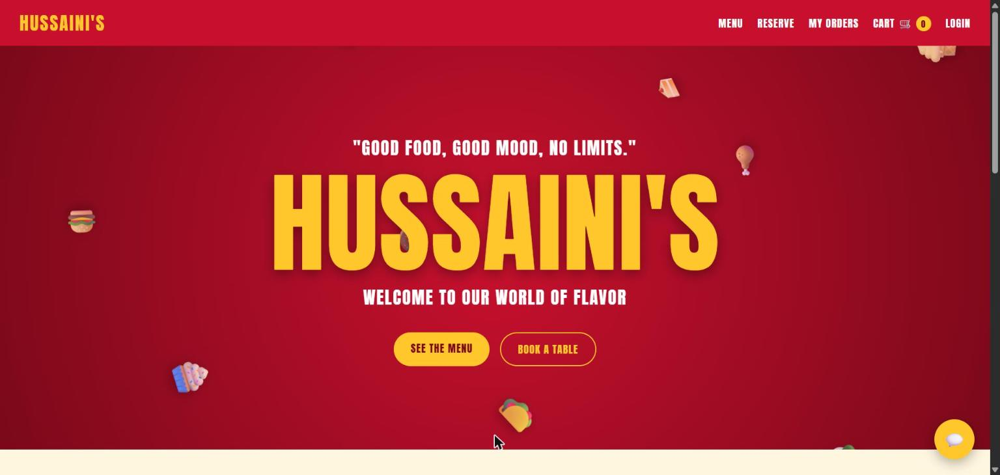
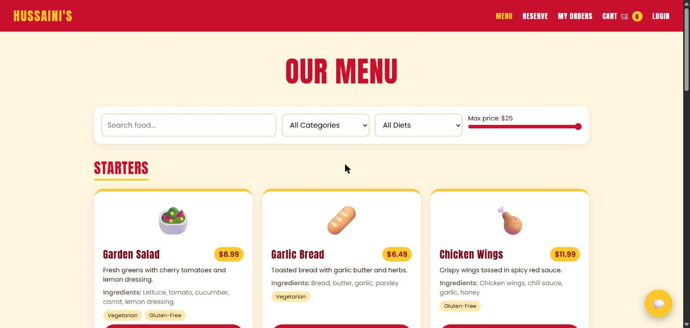
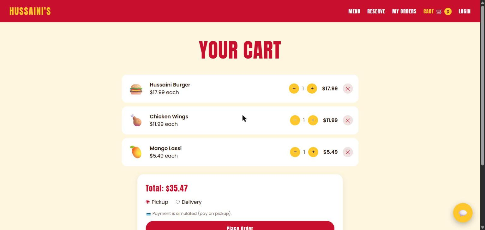
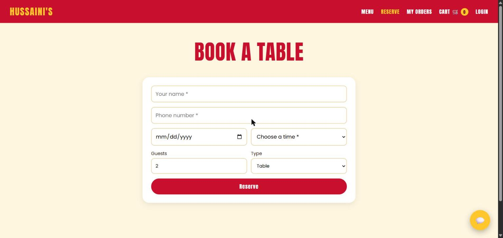
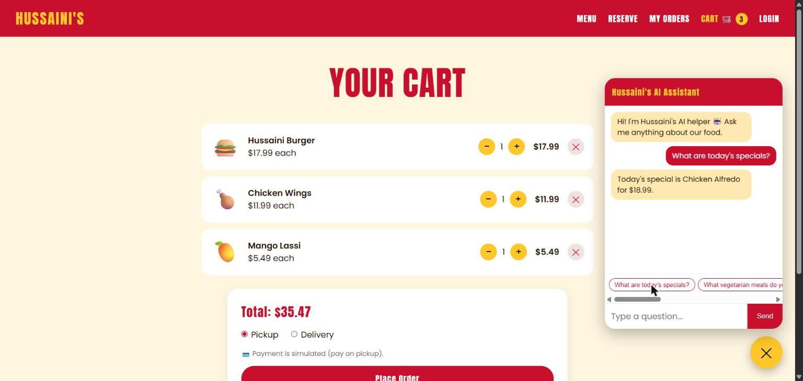
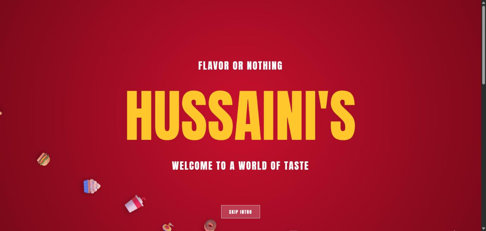
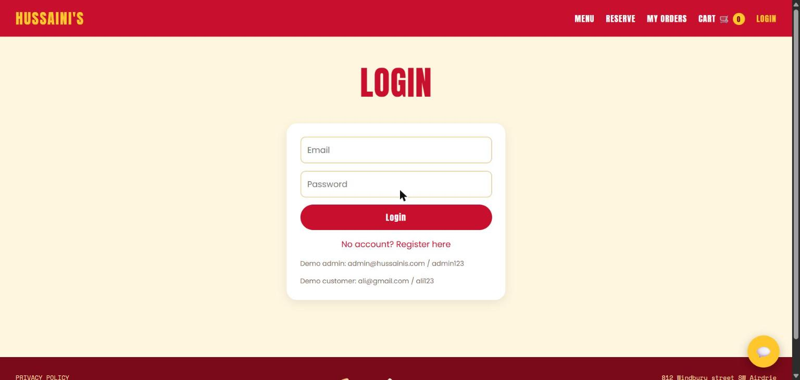
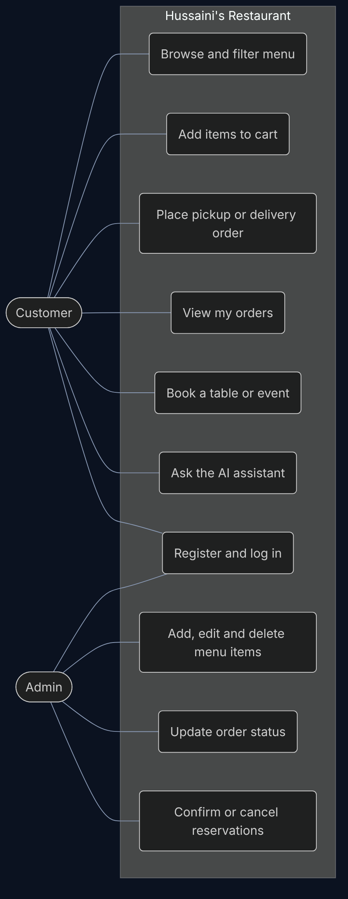
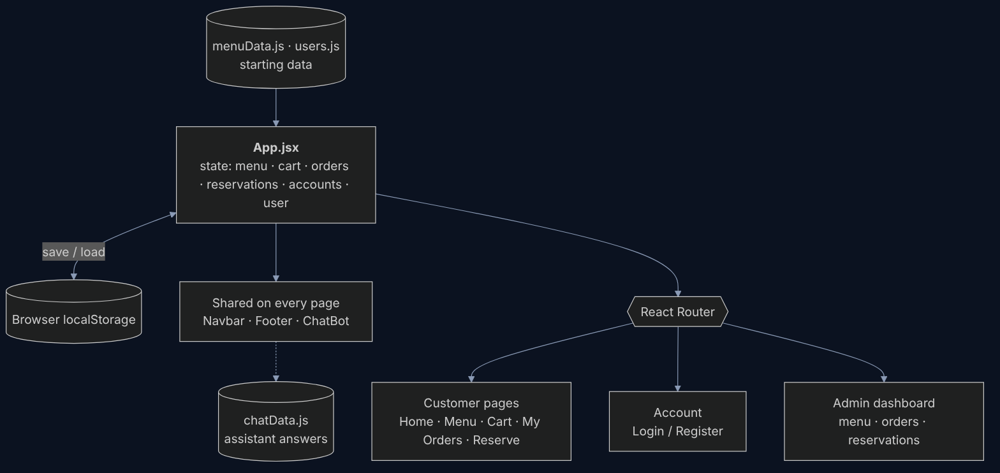
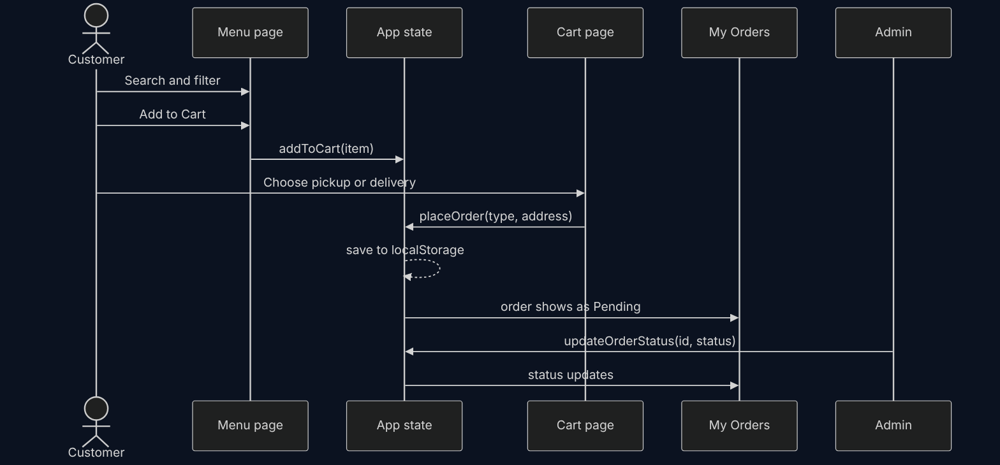

# Hussaini's – Smart Restaurant Management System

**React frontend** · SODV2201 Final Project (Assignment 1)
**Live demo:** [frontend-lake-rho-45.vercel.app](https://frontend-lake-rho-45.vercel.app/)

A restaurant website built with React. Customers browse the menu, order for pickup or delivery, book tables and events, and ask an AI-style assistant. Admins manage the menu, orders and reservations from a dashboard.



## Screenshots

| Menu with search and filters | Cart (pickup or delivery) |
| --- | --- |
|  |  |
| **Book a table or event** | **AI assistant** |
|  |  |
| **Animated intro** | **Login and register** |
|  |  |

## Features

**Customers**
- **Menu:** starters, mains, desserts and drinks, with ingredients, diet tags and prices. Search by name, filter by category, diet and maximum price.
- **Cart and ordering:** change quantities, choose pickup or delivery (with address), place the order. Payment is simulated.
- **My Orders:** see each order and its status as the admin updates it.
- **Reservations:** book a table or a special event (birthday, corporate) for a date, time and number of guests.
- **AI assistant:** a chat widget on every page with quick questions about specials, vegetarian meals and popular items.
- **Accounts:** register and log in.

**Admin**
- Add, edit and delete menu items.
- Track incoming orders and update their status.
- Confirm or cancel reservations.

## Tech stack

| Part | Used |
| --- | --- |
| UI | React 18, JSX, CSS (custom variables, no UI library) |
| Routing | React Router 6 |
| Build tool | Vite 5 |
| Data | React state saved to the browser's `localStorage` (no backend in Part 1) |
| Hosting | Vercel |

## Design

### Use cases


### Architecture
All shared data lives in `App.jsx` and is passed to pages as props. Every change is saved to `localStorage`, so the cart, orders and reservations stay after a refresh.



### Ordering flow


## Project structure

```
frontend/
├── src/
│   ├── App.jsx          # state, localStorage, routes
│   ├── components/      # Navbar, Footer, MenuCard, ChatBot, Intro, FloatingFood
│   ├── pages/           # Home, Menu, Cart, Orders, Reservation, Login, Admin, NotFound
│   └── data/            # menuData.js, users.js, chatData.js (starting data)
├── index.html
└── vite.config.js
```

## Run it locally

```bash
cd frontend
npm install
npm run dev
```

Then open http://localhost:5173.

## Team

| Person | Parts |
| :--- | :--- |
| **Rohullah Hussaini** | Project setup and Vite config, routing and global state, Navbar, Footer, Home (intro and floating food), Menu with search and filters, MenuCard, Cart, My Orders, Reservations and events, main styles |
| **Mohammad Abu Hantash** | Admin dashboard, AI chatbot and its dataset, Login / Register |

See [`TEAM_TASKS.md`](TEAM_TASKS.md) for the full task list and how we managed Git.
